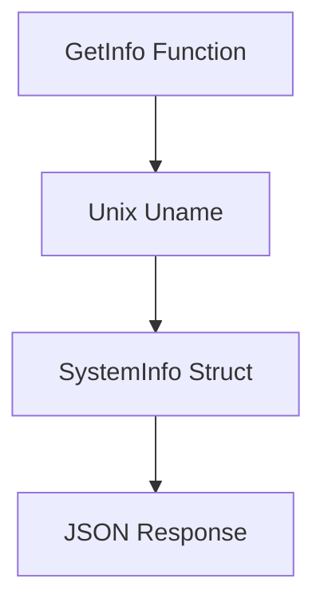

# System Information Component

A component that retrieves and formats system information using the unix package.

## Requirements

1. **System Information Retrieval Requirements**
   - **When** GetInfo is called, **the system shall** return system information including OS, architecture, and a greeting message.
   - **If** system information cannot be retrieved, **the system shall** return an error with descriptive message.

2. **Data Format Requirements**
   - **The system shall** convert system information into a structured SystemInfo object.
   - **The system shall** properly format byte arrays into strings, handling null termination.

## Implementation

### System Diagram

### Components
- SystemInfo Struct: Contains message, OS, and architecture information
- GetInfo Function: Main entry point for retrieving system information
- stringify Function: Converts byte arrays to strings

## Use Cases

- As a system administrator, I want to get formatted system information, so that I can understand the system configuration.
- As an application, I want to receive structured system data, so that I can display it in a consistent format.

### Glossary
- Uname: Unix system call for retrieving system information
- SystemInfo: Struct containing formatted system information